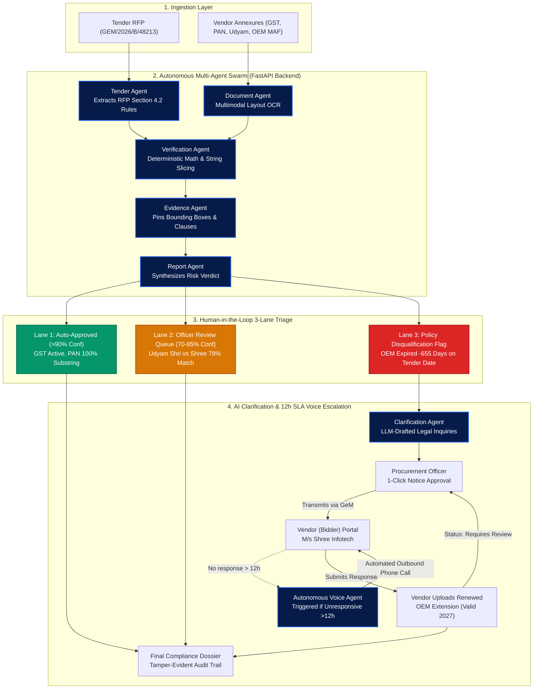
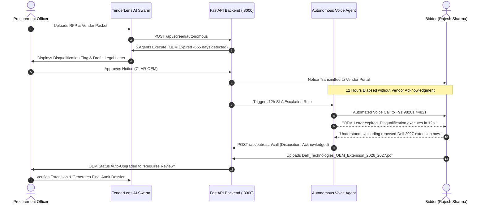
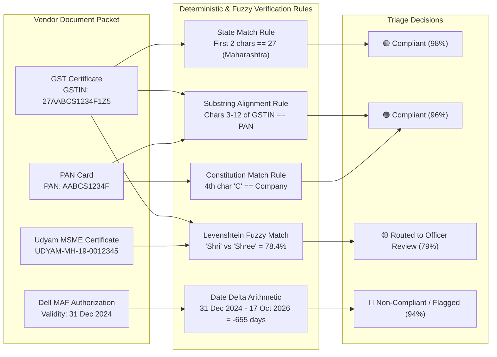

# TenderLens AI — Autonomous Multi-Agent Procurement Compliance Platform

[](https://fastapi.tiangolo.com)
[](https://react.dev)
[](https://www.typescriptlang.org)
[](https://www.python.org)
[](https://tailwindcss.com)

> **Evidence-First Autonomous AI Compliance Engine for Public Procurement, GeM Bids, and Cross-Document Vendor Verification.**

---

## 🏛️ Executive Summary

In public procurement and government tender evaluation (such as India's **GeM Portal**), procurement committees face an overwhelming backlog: cross-verifying thousands of pages of vendor annexures—GSTIN filings, PAN cards, MSME Udyam certificates, and OEM authorization forms.

**TenderLens AI** replaces days of manual clerical labor with an autonomous, evidence-first multi-agent verification swarm that performs deterministic mathematical validation, cross-document entity alignment, and automated legal clarification workflows with **Human-in-the-Loop governance**.

---

## 📊 System Architecture & Multi-Agent Pipeline



---

## ⏱️ 12-Hour SLA Voice Escalation Sequence

When a clarification notice is sent to an unresponsive bidder, TenderLens triggers an autonomous outbound phone call directly to the bidder's registered director:



---

## 🔍 Cross-Document Identity Verification Matrix

How TenderLens reconciles entities across documents using deterministic math and fuzzy scoring:



---

## 🚀 Key Features

### 1. Autonomous Multi-Agent Verification Swarm
- **Tender Agent**: Ingests governing Tender RFPs (e.g., `GEM/2026/B/48213`), extracts mandatory Section 4.2 criteria, and locks tender opening dates.
- **Document Agent**: OCR parsing and entity layout extraction across all vendor annexures.
- **Verification Agent**: Deterministic cross-document matching (PAN string embedded in GSTIN characters 3–12, date arithmetic, Levenshtein fuzzy string scoring).
- **Evidence Agent**: Pins source pages, bounding-box coordinates, and highlights exact clauses.
- **Report Agent**: Synthesizes risk scores into a 3-lane Human-in-the-Loop triage.

### 2. 3-Lane Human-in-the-Loop (HITL) Triage
- 🟢 **Auto-Approved (>90% Confidence)**: Clean registry matches (GST active, PAN 100% substring alignment).
- 🟡 **Officer Review Queue (70% – 85% Confidence)**: Handles fuzzy spelling variances (e.g., Udyam `"Shri Infotech"` vs GST `"Shree Infotech"` at 78.4% match) without unfair automatic disqualification.
- 🔴 **Policy Disqualification Flag (<70% or Lapsed Date)**: Identifies fatal defects (e.g., OEM letter expired $-655\text{ days}$ prior to tender opening).

### 3. Interactive Cross-Document Identity Graph
An interactive SVG visualization mapping vendor entity linkages: GSTIN $\leftrightarrow$ PAN $\leftrightarrow$ Udyam MSME $\leftrightarrow$ OEM MAF.

### 4. Two-User Role Architecture & AI Clarification Assistant
- **Procurement Officer**: Reviews AI-drafted legal inquiries citing Section 4.2 clauses and transmits official notices via the GeM portal with 1 click.
- **Vendor (Bidder) Portal**: The bidder receives formal notices, uploads renewed authorization letters, and submits responses. The document status dynamically upgrades from `Non-Compliant` to `Requires Review`.

### 5. Autonomous 12-Hour SLA Voice Escalation Agent
- If an issued clarification notice is left unacknowledged for **>12 hours**, TenderLens automatically triggers an **Autonomous Outbound Voice Call** to the bidder's registered mobile number (`+91 98201 44821`, Rajesh Sharma, Director).
- Features full duplex speech synthesis, animated audio waveform visualizers, turn-by-turn dialogue transcripts, and multi-channel SMS/WhatsApp delivery.

### 6. Tamper-Evident Audit Dossier
Generates a printable, court-admissible audit trail with exact timestamps, agent execution times (`time_ms`), and officer override logs.

---

## 🏗️ Repository Architecture

```
Tenderlence-AI/
├── tenderlens-backend/                 # Python FastAPI Backend Service (:8000)
│   ├── agents/
│   │   ├── tender_agent.py             # RFP Section 4.2 clause extraction
│   │   ├── document_agent.py           # OCR layout entity extractor
│   │   ├── verification_agent.py       # Cross-document consistency & date math
│   │   ├── evidence_agent.py           # Page & coordinate anchoring
│   │   ├── clarification_agent.py      # LLM legal clarification drafting
│   │   ├── outreach_agent.py           # 12-hour SLA voice escalation agent
│   │   └── report_agent.py             # Compliance score aggregation
│   ├── main.py                         # FastAPI REST application & endpoints
│   ├── models.py                       # Pydantic schemas
│   ├── requirements.txt                # Python dependencies
│   ├── run.py                          # Backend server launcher
│   └── generate_samples.py             # Real PDF sample generator
│
├── tenderlens-verify/                  # Vite + React + TypeScript Frontend (:8080)
│   ├── src/
│   │   ├── lib/api.ts                  # REST API client connecting to FastAPI
│   │   ├── routes/demo.tsx             # Interactive compliance workspace
│   │   ├── routes/index.tsx            # SaaS landing page & value proposition
│   │   └── components/Logo.tsx         # TenderLens branding
│   └── package.json
│
└── sample_tender_documents/            # 6 Real Sample Procurement PDFs
    ├── Tender_RFP_GEM_2026_48213.pdf
    ├── GST_Certificate.pdf
    ├── PAN_Card.pdf
    ├── Udyam_Certificate.pdf
    ├── OEM_Authorization_Dell_Expired.pdf
    └── Dell_Technologies_OEM_Extension_2026_2027.pdf
```

---

## ⚡ Getting Started

### 1. Clone the Repository
```bash
git clone https://github.com/rushirathod22/Tenderlence-AI.git
cd Tenderlence-AI
```

### 2. Run the Python FastAPI Backend
```bash
cd tenderlens-backend
pip install -r requirements.txt
python run.py
```
> **Backend is live at:** `http://localhost:8000`  
> **Interactive Swagger Documentation:** `http://localhost:8000/docs`

### 3. Run the React Frontend
```bash
cd ../tenderlens-verify
npm install
npm run dev
```
> **Frontend is live at:** `http://localhost:8080`  
> **Direct Demo URL:** `http://localhost:8080/demo`

---

## 📡 Live API Endpoints

| Method | Endpoint | Description |
| :--- | :--- | :--- |
| `GET` | `/api/health` | Health check & registered agent swarm status |
| `POST` | `/api/screen/autonomous` | Executes 5-agent compliance pipeline on tender packet |
| `POST` | `/api/upload/file` | Multipart file upload into backend OCR engine |
| `POST` | `/api/clarifications/action` | Officer approval/transmission & vendor reply submission |
| `POST` | `/api/outreach/call` | Autonomous voice escalation phone call trigger (12h SLA) |
| `GET` | `/api/report/{tender_id}` | Aggregated tamper-evident compliance audit dossier |

---

## ⚖️ Zero-Tolerance Verification Logic

| Document | Verification Method | Formula / Criterion | Verdict |
| :--- | :--- | :--- | :--- |
| **GSTIN** | Deterministic Regex & State Check | `^[0-9]{2}[A-Z]{5}[0-9]{4}[A-Z]{1}[1-9A-Z]{1}Z[0-9A-Z]{1}$` + State `27` | 🟢 Compliant (98%) |
| **PAN** | Substring Alignment | Chars 3–12 of GSTIN $\equiv$ PAN `AABCS1234F`; 4th char `C` = Company | 🟢 Compliant (96%) |
| **Udyam MSME** | Levenshtein String Similarity | `"Shri Infotech"` vs `"Shree Infotech"` $\to$ Similarity: $78.4\%$ | 🟡 Requires Review (79%) |
| **OEM MAF** | Date Delta Arithmetic | $\text{Expiry (31 Dec 2024)} - \text{Tender (17 Oct 2026)} = -655\text{ days}$ | 🔴 Non-Compliant (94%) |

---

## 👥 Contributors & Hackathon Team
- **TenderLens AI Development Team**
- Built for **VOYAGEHACK 3.0**
